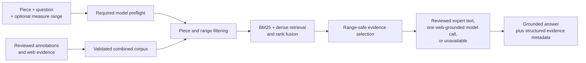

# RAG+LLM pipeline

The pipeline answers a musical-performance question from reviewed expert
annotations and supporting web evidence. A finalized expert answer bypasses
free-form generation. The local answer model is called exactly once only when
the leading primary evidence is directly supported, answer-eligible web
material. Insufficient or ambiguous authority produces an explicit
unavailable result.

Its central rule is:

> The question determines **what** to retrieve, while the optional measure
> range determines **where** the evidence must apply.



## 1. Build the corpus

The system first builds one local corpus from two sources:

- **Expert annotations:** reviewed knowledge units from
  `soprano-qa-dataset/expert_curation/review/`
- **Web evidence:** validated, answer-eligible records from the scraped
  database

An expert record contains:

- its curated answer;
- permanent knowledge-unit and source IDs;
- original expert questions used as retrieval aliases;
- confirmed measure ranges;
- the finalized location status needed for routing; and
- materialized relevance text used by lexical and dense retrieval.

It deliberately does not contain raw source answers, legacy range hints,
annotator names, rewrite or measure notes, review warnings, or other editorial
workflow fields. Those remain in the dataset repository for curation and
audit. `python scripts/build_corpus.py` validates all five review documents,
fails closed unless every unit is finalized, projects the strict release
schema, rejects forbidden or unexpected fields, and atomically rewrites
`data/corpus.json` and `data/corpus_stats.json`.

Human `source_ids` and web `web_source_ids` remain separate so the origin of
each claim is clear.

Only confirmed measure ranges are used for routing. Older range hints are
validated at the dataset boundary but are not copied into the release corpus
and never select raw source prose for generation.

Corpus construction is fail-closed. Every expert knowledge unit must have a
`ready` rewrite and a finalized measure status; otherwise the builder reports
the offending IDs and stops before provisional material can be retrieved.

The resulting searchable artifact is `data/corpus.json`.

## 2. Receive a query

Every query contains:

```text
piece_id + question + optional measure_range
```

For example:

```json
{
  "piece_id": "die-forelle",
  "question": "피아노 파트에서 두 번째 박의 악센트는 무엇을 표현할까?",
  "measure_range": [2, 27]
}
```

The measure range is structured metadata. It does not need to appear in the
question text.

If the question itself mentions a measure, that location must fall inside the
structured range. The structured range is the allowed envelope, while the
explicitly mentioned location becomes the effective retrieval and grounding
scope inside that envelope. Thus a UI selection of bars 14--63 plus a question
specifically about bar 63 cannot borrow evidence that applies only to bars
14--42. Conversely, a structured range may be supplied even when the question
does not repeat its measure numbers.

If no range is supplied, it means **no range was selected**. It does not
automatically mean that every retrieved annotation applies to the whole
piece. A retrieved unit's confirmed ranges may still constrain routing and
scope validation, but they remain structured metadata and are not copied into
the answer unless the user supplied or explicitly requested a location.

For a generated request, the service validates and loads the configured answer
checkpoint and backend before corpus or index work. Hybrid retrieval validates
its embedding checkpoint and backend before corpus rebuilding. A missing,
unreadable, or incompatible required model raises an error and stops the
request.

## 3. Retrieve relevant evidence

Retrieval proceeds in this order:

1. Keep only records for the selected piece.
2. Apply the selected measure range.
3. Run the existing Korean concept and BM25 search, including strict
   expert-question alias matching.
4. Independently embed the natural-language question and retrieve semantically
   similar knowledge units, allowing paraphrases outside the lexical concept
   gate to enter the candidate set.
5. Treat a terminal Korean answer relation such as `의미하다`, `표현하다`,
   or `상징하다` as a soft intent concept when the remaining content concepts
   are fully covered on the lexical path.
6. Fuse lexical and dense ranks with weighted reciprocal-rank fusion. Exact
   source-question aliases establish annotation-family recall within the same
   scope; they do not by themselves establish which split knowledge unit has
   answer authority.
7. Select a small set of records that collectively covers the question. For
   a no-range request, this includes the semantic-local focus check described
   below before any model-context truncation is allowed.

When the user has not selected a range, finalized expert units receive no
ranking advantage or penalty merely because their confirmed location is
whole-piece, passage-specific, or unspecified. Their reviewed question and
answer semantics decide relevance. A selected range still gives strict
priority to overlapping expert units.

Dense retrieval uses the local `Qwen3-Embedding-0.6B-Q8_0.gguf` checkpoint.
Knowledge-unit relevance and answer vectors are normalized and cached using a
fingerprint of the corpus text, model file, and embedding runtime settings. A
question receives an English retrieval instruction and is embedded once per
new normalized question in a process; a bounded hash-keyed cache reuses the
query vector across repeated requests. Direct dot products over the 446
cached vector slots replace the need for a vector database. Dense model
loading and inference use the existing `llama-cpp-python` runtime.

Dense similarity never overrides corpus authority. Release-corpus admission,
piece identity, topic when present on web records, finalized expert measure
status, and range relationship are checked independently for both candidate
paths. A dense-only result for a
selected range must overlap that range; confident lexical evidence may still
report a confirmed non-overlapping annotation as secondary context. Low
similarity floors remove remote neighbours, while two precision guards handle
cases cosine similarity cannot separate: the query must have a music-domain
anchor, and an answer must support explicitly requested attributes such as
fingering, harmony analysis, BPM, page location, physical units, or a
left-versus-right assignment. These checks apply only to dense-only admission,
not to records already justified by the lexical path. Hybrid mode requires its
embedding checkpoint and backend. A missing checkpoint fails before corpus or
answer work begins, and runtime embedding failures propagate as hard errors;
model-free retrieval is available only through explicit lexical mode.

For a range-selected query, dense-only overlap is not enough when the leading
candidates are semantically ambiguous. If two overlapping expert units are too
close to distinguish and lexical or alias evidence does not resolve them, the
retriever admits neither one. The service returns `unavailable` /
`no_corpus_evidence` rather than letting a small cosine-score difference choose
the meaning of the answer.

Source questions can contain several facets and are intentionally copied to
every knowledge unit produced from that source annotation. The retriever
therefore treats a source-question-led match as family recall, then checks the
reviewed answer text to resolve causal versus procedural authority. When a
pure causal question reaches a family containing an explicit causal unit and
a technique-only sibling, only the causal unit may answer. If the effective
selected range overlaps only the technique sibling, the system returns
`unavailable` rather than borrowing the causal statement from another range.
This check applies to lexical, ordinary dense, hybrid, and source-question-led
matches. Mixed questions that explicitly ask both why and how retain both
reviewed facets. Incidental strings such as `의도치 않게`, `이유 없이`, and
`왜곡되지 않게` are treated as procedural wording, not causal requests.

The soft relation path is deliberately separate from expert-question alias
matching: aliases remain strict because a positive alias match is authoritative
for evidence selection. A range-overlapping soft match may replace a merely
global surface-form hit, but the soft path returns only its best explanatory
record. Noun uses such as `가사의 의미`, performance requests such as
`어떻게 표현해야 하나요?`, and unmatched content concepts remain strict.

### When a measure range is selected

Ranges are inclusive. The retriever checks every requested interval against
every confirmed interval on each record.

| Evidence scope | Retrieval relation | Result |
| --- | --- | --- |
| A confirmed range intersects the selected range | `overlaps_query_range` | Kept and strongly preferred |
| No local range; explicitly whole-piece or global | `global_context` | Kept only when semantically relevant |
| Confirmed local ranges do not intersect | `other_range_context` | Kept as lower-ranked context only |
| Location is `unspecified` | Unconfirmed | Not used in a range-selected query |

`waiting_for_review` is a dataset workflow state, not a production retrieval
state: the schema-8 corpus builder rejects it before writing the release
artifact.

For example, evidence with confirmed ranges `[[2, 27], [41, 54]]` overlaps a
query for `[2, 27]`, but it does not overlap `[28, 40]`.

The range contribution to ranking is:

| Relation | Score adjustment |
| --- | ---: |
| Overlapping recurring expert evidence | `+6.0` |
| Other overlapping evidence | `+5.0` |
| Global context | `+0.25` |
| Confirmed non-overlapping local evidence | `-1.0` |

Scope priority is applied before lexical or fused relevance. Therefore, an
overlapping record ranks ahead of global context even if the global record has
more lexical overlap. If any semantically relevant overlapping candidate
exists, the final selected set must contain overlapping evidence.

Semantically relevant confirmed non-overlapping records are retained after
overlapping and global records. They receive
`evidence_role: other_range_context_only`. This preserves useful annotations
for inspection and lets the pipeline detect a possible range mismatch, but
their claims cannot be transferred to the selected passage or cited as its
grounding.

If no relevant overlapping record exists, semantically relevant global and
other-range context may still be returned. Global evidence can explain
general background. Other-range evidence is shown separately, while the
answer states that no evidence directly supports the selected range.

A web record can support an exact measure claim only when it identifies both
the applicable edition and its measure-numbering system. Otherwise it is
treated only as global context.

Only the best one or two semantically matching other-range records are kept.
In a mixed LLM prompt, only a temporary context label plus piece, work, range,
and scope-relation metadata are exposed as a range-mismatch signal; permanent
record IDs and musical claims are withheld from generation.
The complete records are still returned in the service evidence list for
inspection. A secondary-only result is not sent to the LLM as selected-range
grounding. If a generated draft nevertheless cites secondary evidence, the
draft is discarded. Only reviewed expert text that has already passed the
authority and scope checks may be rendered deterministically; raw web prose is
never exposed as a generation-failure substitute.

### When no measure range is selected

- No range-overlap filter is applied.
- Whole-piece and global evidence establishes claims about the piece in
  general.
- A finalized, measure-specific expert unit may nevertheless be the primary
  answer when it is the clearly strongest semantic match. The unit remains a
  local example; omitting a UI range does not convert it into whole-piece
  authority.
- The focus check compares two dense views: the record's retrieval text and
  its reviewed answer. A local unit is accepted when both views lead competing
  sources by at least `0.025`, or through a conservative relevance-led path:
  relevance similarity at least `0.65`, a relevance lead of at least `0.05`,
  answer similarity no more than `0.05` behind the best competitor, and either
  supporting hybrid lexical evidence or dense relevance of at least `0.70`.
  The normal absolute floors are `0.44` for retrieval text and `0.43` for
  answer text.
- A separate source-question-led path covers finalized expert answers whose
  reviewed wording explains the answer without repeating the question's key
  nouns. It is available only to a clean local expert record with a confirmed
  range, source IDs, and source-question aliases. Those aliases recall the
  immutable annotation family; answer-side relation and scope checks choose
  the authoritative unit within it. That record
  must be the raw relevance winner with at least `0.64` similarity, at least
  `0.40` answer similarity, and a `0.10` lead over every other source. The
  ordinary domain-anchor and explicit-answer-constraint guards still apply.
  Only this marked winner may bypass the general answer floor and alias-gap
  test; the global thresholds are not relaxed.
- Semantic selection always sees a stable pool of at least six candidates.
  The decision is made once and frozen for answer delivery, so a competitor
  cannot disappear merely because a caller requested a smaller returned
  `top_k`.
- An unrelated fusion-ranked record ahead of the dense winner prevents local
  focus. Finalized knowledge units split from the same expert source are the
  only exception: the direct local winner moves first and its same-source
  siblings may follow. No mixed-source bundle is created by this exception.
- For a broad question about how to sing the piece, retrieval deliberately
  mixes whole-piece guidance with a small, varied set of confirmed local
  annotations about technique, diction, rhythm, and interpretation.
- If one selected expert source was curated into several complementary
  knowledge units, the broad result keeps its same-scope siblings together.
  This preserves combinations such as tone-colour and diction advice without
  joining unrelated annotations merely because the question is broad.
- The question may also name one of those facets, such as breathing,
  pronunciation, or musical expression. In that case, the broad search keeps
  only guidance that actually mentions the requested facet.
- A confirmed local annotation is labeled `local_example` internally. Its
  exact `measure_range` remains routing and evidence metadata when the user
  did not select or request a location. The displayed answer uses natural,
  conditional or passage-local wording instead of exposing that label or its
  canonical numbers. This still does not prove that the same feature occurs
  throughout the piece, often, or in many places.
- Pending annotations are absent because release corpus construction rejects
  them before retrieval.

For example, if a local annotation says that a high note is not on the strong
beat and has confirmed ranges `[[63, 63], [82, 83]]`, those ranges remain in
the evidence metadata while a no-range answer may say naturally:

```text
고음이 강박에 놓이지 않는 대목에서는 단어와 음악의 강세 관계에 유의해 유연하게 노래하는 것이 좋습니다.
```

It may not turn the local annotation into “이 곡에는 이런 부분이 많이
나온다” unless separate whole-piece evidence explicitly supports that
frequency claim. Old source-text locators, legacy hints, and unrequested
canonical ranges never enter the displayed prose.

The question is normalized before lexical matching: piece names, measure
expressions, and generic question wording are removed from the lexical query.
Korean concept normalization and BM25 are then used together. Dense query
preparation removes piece and measure routing syntax but keeps the natural
question wording. Structured output reports `concept_coverage`,
`content_concept_coverage`, `answer_relation_score`, `dense_score`,
`dense_content_score`, `fusion_score`, `retrieval_mode`, and
`semantic_match_type`, making lexical,
dense, strict, and soft matches distinguishable. Alias-enriched concepts can
help find candidates, but a lexical soft match also requires explanatory
language and content anchors in the knowledge-unit answer itself.

Range overlap alone is never enough. A record must also be semantically
relevant to the question.

When an original expert-question alias strongly matches the user question,
the strongest range-applicable expert records remain primary. Up to two
confirmed non-overlapping alias matches may follow as explicitly secondary
context; a stronger other-range alias can never displace overlapping
evidence. When an alias does not match, the stable two-view semantic check can
focus a paraphrased no-range question on the direct local expert bundle.

## 4. Select the answer authority

When the selected primary evidence contains a finalized expert annotation,
the system keeps each selected knowledge unit's complete curated `answer` as
an indivisible authority. It preserves retrieval order, removes duplicate
answer text, and keeps separate units in separate paragraphs. It does not ask
Qwen to summarize, merge, or paraphrase those expert claims. This prevents a
language model from changing an agent, predicate, causal relation, negation,
modality, or scope while retaining superficially similar words.

The displayed text receives only deterministic presentation cleanup and
formal-polite Korean ending normalization. The result is reported as
`generation_mode: expert_verbatim` and `answer_basis:
authoritative_expert`; this is the direct authoritative answer policy. Web
prose is not mixed into the displayed answer when a direct
finalized expert bundle is available, although every retrieved record remains
available in structured evidence metadata.

## 5. Construct a range-safe prompt when generation is needed

If no direct finalized expert bundle is available, synthesis is considered
only when the leading primary record is directly supported, answer-eligible
web evidence. The prompt contains only the frozen selected evidence,
including:

- temporary citation labels plus piece and work context, and topic when
  present on web records;
- user-selected ranges and their relation to the evidence, when applicable;
- whether each record is selected-range support, general context, or
  other-range context only;
- curated expert answers;
- web edition and rights information when relevant.

For a no-range query, a local unit's canonical range is withheld from the LLM
as well as from displayed prose. Raw source wording and editorial fields are
absent from the release corpus, so corrected typos and resolved conflicts
cannot re-enter the response.

Two safeguards prevent raw claims from leaking between ranges: confirmed
knowledge-unit ranges control routing, while the prompt always uses the
reviewed knowledge-unit answer rather than source-level wording. If one source
answer was split into several knowledge units, its full text is therefore not
copied back into any unit prompt.

The LLM is instructed to:

- answer only from retrieved evidence;
- preserve the expert's uncertainty, alternatives, and practical nuance;
- avoid inventing measures, notation, lyrics, pronunciation, or vocal advice;
- use a `local_example` only when it directly answers the question, keep the
  claim conditional or passage-local, and never generalize it to the whole
  piece;
- never cite, paraphrase, or apply an `other_range_context_only` claim to the
  selected range; and
- treat temporary evidence labels, canonical ranges, and scope roles as
  internal grounding data rather than user-facing prose.

After generation, the pipeline checks these rules. A different whole-piece
record does not silently broaden a local claim, and local evidence cannot
support whole-piece or frequency wording. A measure locator may appear only
when the user selected or explicitly requested it; unrequested canonical,
source-only, and legacy locators are rejected. Internal field names, evidence
labels, and presentation headings are also rejected. Finalized expert answers
do not depend on this post-generation check because they bypass free-form
generation altogether.

An annotation that still requires human review cannot enter a release corpus;
the build fails instead of showing review workflow text to a user.

## 6. Generate and validate authoritative web answers

Only a directly supported leading web record can authorize free-form
synthesis. The service sends its frozen evidence bundle to the configured
local answer model exactly once.

After generation, the application:

- rejects an empty or explicit no-answer draft;
- rejects unsupported tokens, context-only citations, local-to-global
  overgeneralization, missing review limitations, and forbidden internal
  metadata;
- validates temporary labels such as `[E1]`, permits citations only to primary
  grounding, then removes labels and opaque corpus IDs from user-visible
  prose;
- removes internal scope headings and canonical measure locators that the user
  did not select or request;
- removes generated evidence footers;
- normalizes the answer to formal-polite Korean; and
- returns exact source IDs and web rights notices separately as structured
  metadata.

The pipeline makes no second model call. Model/backend failures, context
errors, and draft-validation failures propagate to the caller. Raw web prose
is never substituted for a failed draft. Insufficient or ambiguous evidence
is handled earlier, before a model call, as `generation_mode: unavailable`,
`answer_basis: no_corpus_evidence`, with a structured `unavailable_reason`.

## 7. Returned result

The service returns:

- the user-visible answer or explicit unavailable message;
- one of the three generated answer paths: `expert_verbatim` /
  `authoritative_expert`, `llm` / `retrieved_evidence`, or `unavailable` /
  `no_corpus_evidence`;
- a structured `unavailable_reason` for the unavailable path;
- whether primary and selected-range grounding exist, plus the role of every
  evidence record and whether confirmed local examples are present;
- the selected measure range; and
- the exact evidence records and retrieval scores.

Canonical evidence ranges, provenance, generation mode, and scope roles remain
available in this structured result for auditing. The `answer` field itself is
natural singer-facing prose: it omits internal labels such as `local_example`,
`범위 안내`, and `확인된 국소 예시`, as well as canonical range numbers that
the user did not select or request.

The most important distinctions are:

```text
finalized expert authority → direct reviewed answer
directly supported leading web evidence → one grounded LLM answer
ambiguous or unsafe grounding → explicit unavailable answer
```

With generation disabled, the service can return a separate retrieval-only
diagnostic result. It is not one of the generated answer paths above.

## Evaluation interpretation

Answer-fidelity judgment uses the authenticated Codex CLI as its sole LLM
backend. The judge starts one structured `codex exec` process per case through
a dedicated authenticated provider alias. WebSocket transport is disabled,
and the provider's HTTP-request and SSE-stream retry counts are both zero. The
script performs no automatic retry; a missing login or model, timeout, command
failure, or invalid structured response aborts the run.

For semantically self-contained measure-scoped questions asked without a UI
range, retrieval must place any required finalized expert unit within the first
three results. Hit@3 is therefore the minimum acceptance criterion. Hit@1 and
MRR remain the primary ranking-quality signals, while Hit@6 is recorded only
as a broader recall diagnostic and must not hide a Hit@3 regression. Generated
answer fidelity is evaluated separately because a retrieval hit alone cannot
prove that the answer is complete, correctly scoped, or free of unsupported
generalization. The scope check uses canonical ranges from structured
authority metadata; it does not require those unrequested locators or any
pipeline label to appear in user-visible prose.

## Implementation map

| Pipeline stage | Main file |
| --- | --- |
| Corpus construction | `soprano_qa/corpus.py` |
| Measure handling and retrieval | `soprano_qa/retrieval.py` |
| Prompt construction and answer finalization | `soprano_qa/answer.py` |
| End-to-end orchestration | `soprano_qa/service.py` |
